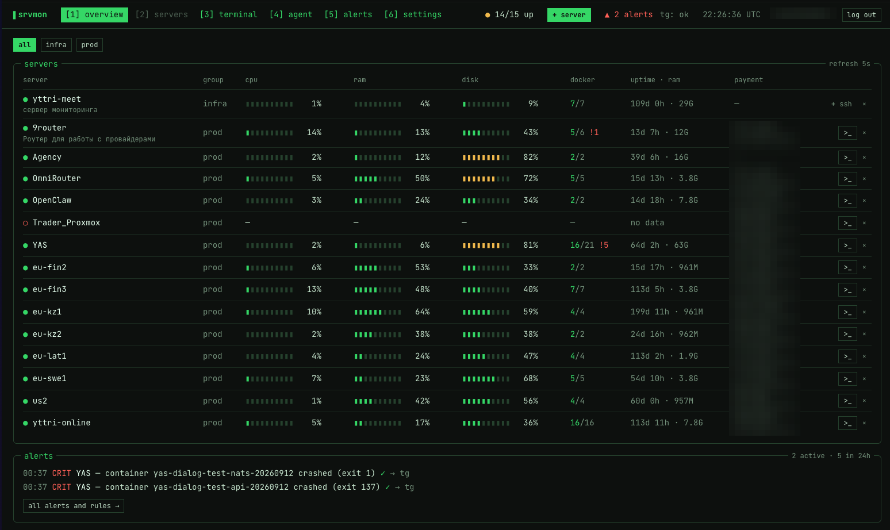
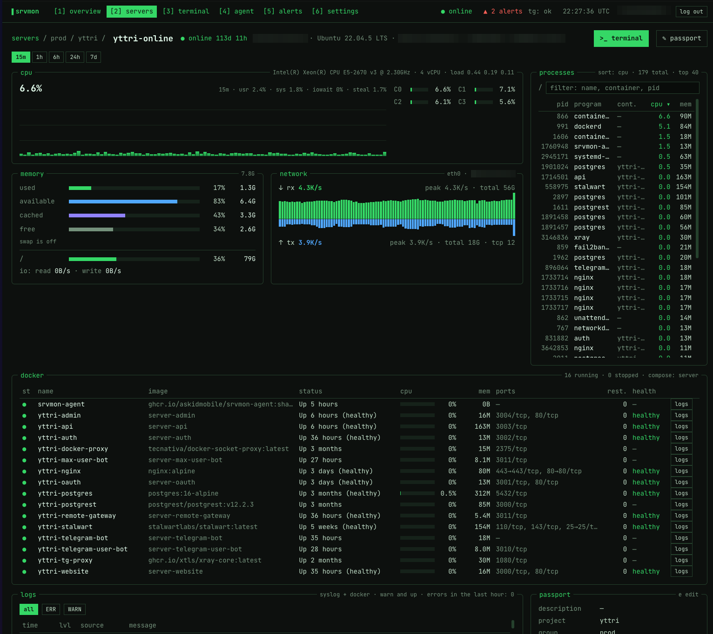
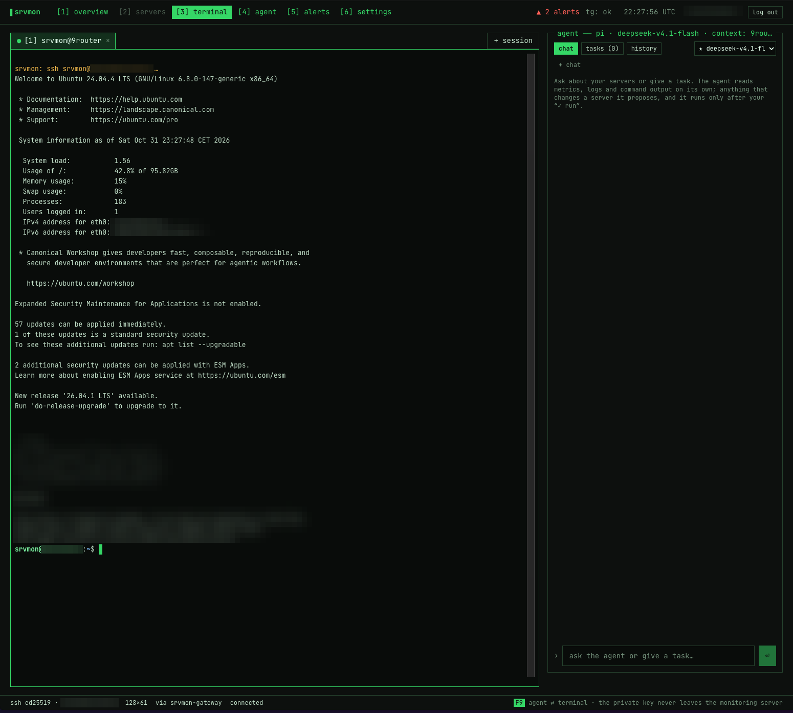
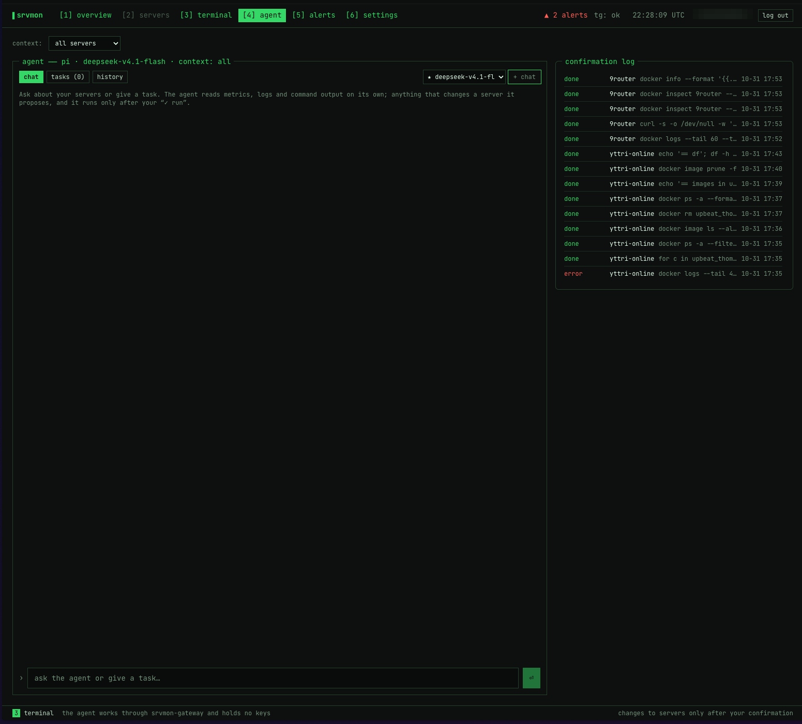
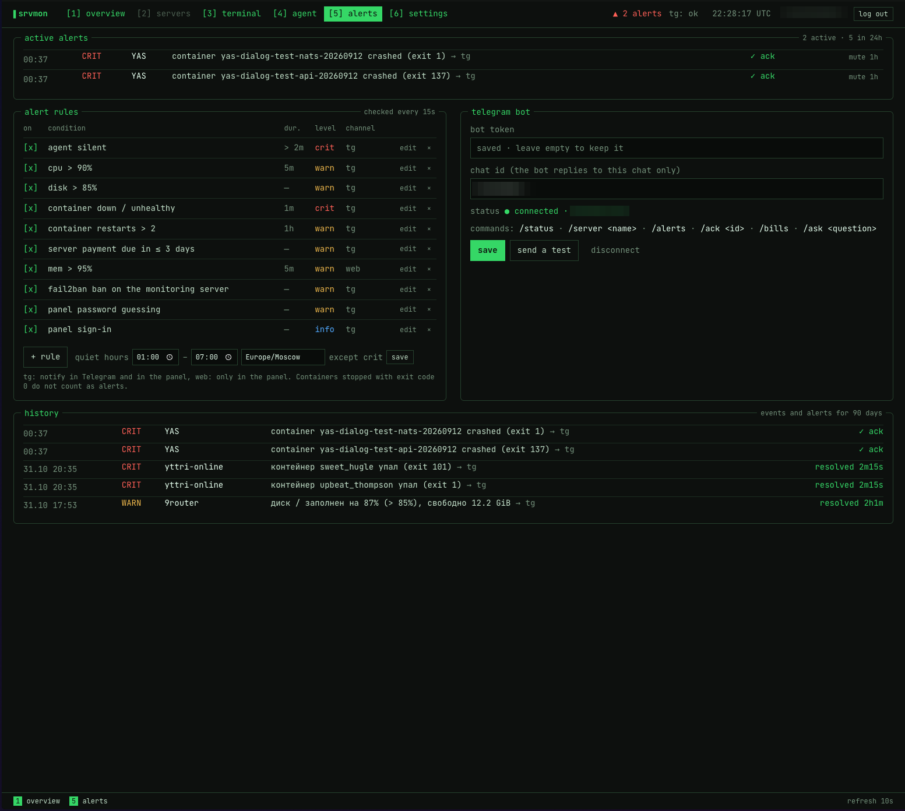
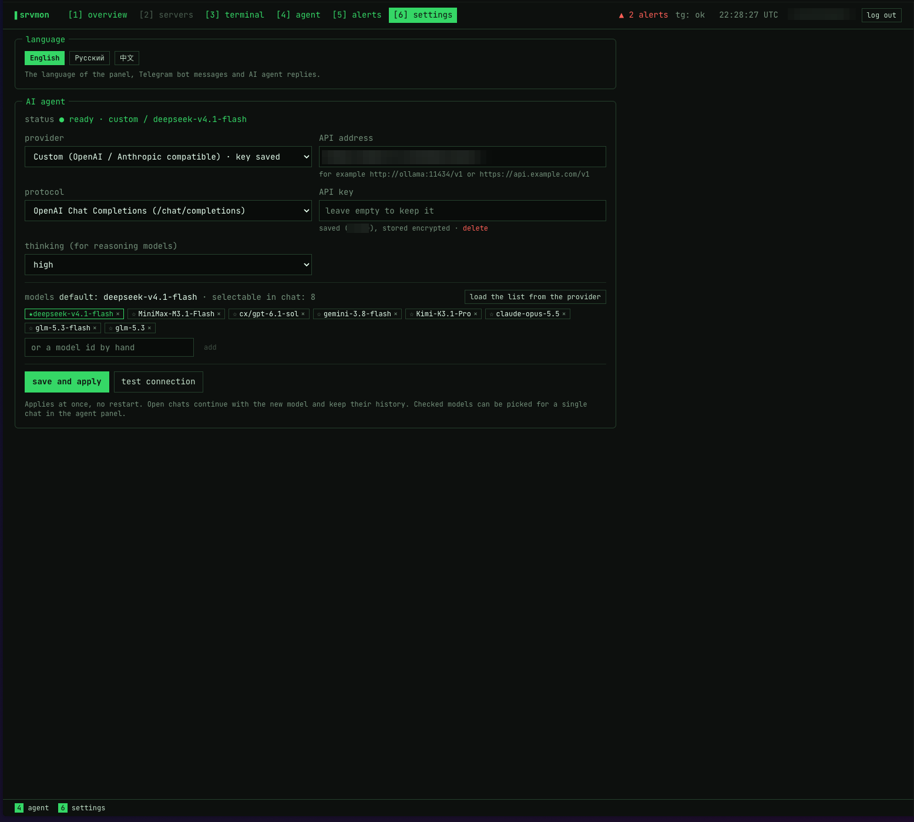

# srvmon

[English](README.md) · **Русский** · [中文](README.zh-CN.md)

Self-hosted панель мониторинга своих серверов: метрики и docker-контейнеры, SSH-терминал в браузере, AI-агент, который работает на серверах с вашего подтверждения, и алерты в Telegram. Вход по паролю + код TOTP (Google Authenticator и совместимые), подбор блокирует fail2ban.

Интерфейс в стиле TUI (как btop), тёмная тема с зелёным акцентом. Интерфейс на английском (по умолчанию), русском и китайском; язык переключается в настройках и действует также на сообщения Telegram-бота и ответы AI-агента.



- Архитектура: [docs/architecture.md](docs/architecture.md)
- Макеты: [docs/design](docs/design)
- Требования к серверу мониторинга: [docs/server-requirements.md](docs/server-requirements.md)
- Telegram-бот, если `api.telegram.org` недоступен (хостинг в России): [docs/telegram-proxy.md](docs/telegram-proxy.md)

## Возможности

- **Обзор.** Одна таблица на все серверы: полоски CPU, RAM и диска, запущенные/всего контейнеры (с отметкой упавших), uptime, объём RAM, ближайшая оплата хостинга и её дата, последние алерты. Фильтр по группам, терминал в один клик. Горячие клавиши: `1` обзор, `3` терминал, `4` агент, `5` алерты, `6` настройки.
- **Метрики и контейнеры.** Небольшой агент на Go (`srvmon-agent`) на каждом сервере читает CPU, RAM, swap, load, диски, сеть и uptime из `/proc`, контейнеры через docker.sock (только чтение) и отправляет их в панель. При потере связи буферизует данные до часа. Метрики хранятся в VictoriaMetrics.
- **Экран сервера.** CPU по ядрам, память, диски, сеть, процессы, контейнеры со статусом, health и рестартами, логи syslog и docker; всё обновляется, пока экран открыт.
- **Паспорт сервера и оплаты.** У каждого сервера есть паспорт: описание, проект, группа, теги, провайдер, тариф, стоимость с валютой и дата следующей оплаты. Оплаты видны в обзоре, в Telegram (`/bills`) и приходят алертом за несколько дней до срока.
- **Мастер добавления.** Проверка host key, разовый вход по паролю или своему ключу. srvmon создаёт пользователя `srvmon` со своим ed25519-ключом, ставит агента и по желанию выключает вход по паролю. Разовый пароль или ключ нигде не сохраняется.
- **Веб-терминал.** xterm.js ↔ WebSocket ↔ SSH-клиент в `srvmon-server` ↔ sshd. Вкладки, resize, `docker exec` в контейнер. Рядом с терминалом панель AI-агента (`F9` показывает и прячет её), работающая в контексте этого сервера. Приватные ключи не покидают сервер мониторинга и хранятся зашифрованными (XChaCha20-Poly1305).
- **AI-агент.** На SDK [pi](https://pi.dev), любой провайдер (DeepSeek, Anthropic, OpenAI, OpenRouter, Google, Ollama, любой OpenAI- или Anthropic-совместимый адрес). Команды только для чтения выполняются сразу, всё, что меняет сервер, ждёт вашего подтверждения. Решает `srvmon-server`, а не модель. У каждого сервера свой контекст чата, чаты хранят историю, модель выбирается для каждого чата. Задачи по расписанию (cron) отчитываются в Telegram, а спросить агента из Telegram можно командой `/ask`.
- **MCP-сервер.** Claude Desktop, Cursor и Claude Code подключаются к `/mcp` по отзываемым токенам с правами. Инструменты те же, и изменения так же подтверждаются в панели или Telegram.
- **Алерты и Telegram.** Агент молчит, контейнер упал или unhealthy, рестарты, CPU, диск, скорая оплата хостинга, баны fail2ban, попытки входа. Правила настраиваются (порог, длительность, уровень, канал: Telegram или только панель). Тихие часы в вашем часовом поясе (критичные алерты всё равно приходят), ack и «тишина», история за 90 дней, AI-диагноз к критичным алертам. Бот отвечает на `/status`, `/server`, `/alerts`, `/ack`, `/bills`, `/ask`.
- **Пульс панели (dead man's switch).** Раз в минуту панель проверяет себя и пингует внешний URL, например [healthchecks.io](https://healthchecks.io). Если панель упадёт, пинги прекратятся, и сервис предупредит вас письмом или по своим каналам.
- **Безопасность.** Пароль (argon2id) + TOTP или резервный код, без логина. Rate limit, журнал аудита, jail'ы fail2ban для панели и sshd.

## Скриншоты

**Экран сервера**: CPU по ядрам, память, сеть, процессы, docker-контейнеры с health и логами, паспорт.



**Веб-терминал** с панелью AI-агента справа (`F9`).



**AI-агент**: чат, задачи и история, выбор контекста сервера и модели, журнал подтверждённых команд.



**Алерты**: активные алерты, редактируемые правила, тихие часы, Telegram-бот и история.



**Настройки**: язык, провайдер AI, протокол, ключ API, уровень размышлений и модели, доступные в чате.



Чувствительные данные (адреса, оплаты, id чата, ключи) на скриншотах размыты.

## Состав

| Часть | Где | Что умеет |
| --- | --- | --- |
| `srvmon-server` | `cmd/server`, `internal/` | API, вход, SQLite, алерты, Telegram-бот, SSH-шлюз, встроенный фронт |
| `srvmon-agent` | `cmd/agent`, `internal/agent` | Метрики хоста и контейнеров, push на сервер |
| `srvmon-ai` | `ai/` | AI-агент (pi SDK) только с инструментами srvmon, без своих SSH-ключей |
| Веб | `web/` | React + Vite + Tailwind 4, компоненты в стиле shadcn/ui, xterm.js |
| Деплой | `deploy/` | Distroless-образы (amd64 + arm64), compose: Caddy или внешний прокси, server, VictoriaMetrics, fail2ban |
| CI/CD | `.github/workflows/` | `ci.yml` проверки, `release.yml` образы в GHCR, `deploy.yml` выкатка по SSH с откатом |

## Быстрый старт (ручная установка)

Нужен хост на Debian/Ubuntu с публичным IP, домен с A-записью на него и порты 80/443 (или свой reverse proxy). Подробнее: [docs/server-requirements.md](docs/server-requirements.md).

```bash
git clone https://github.com/askidmobile/srvmon.git
cd srvmon
sudo bash deploy/install-host.sh            # ставит docker, если его нет, создаёт /opt/srvmon
sudo cp -r deploy/docker-compose.yml deploy/Caddyfile deploy/remote-deploy.sh \
  deploy/install-host.sh deploy/fail2ban deploy/nginx /opt/srvmon/
sudo nano /opt/srvmon/.env                  # SRVMON_DOMAIN=mon.example.com
cd /opt/srvmon && sudo bash remote-deploy.sh latest
sudo docker compose exec -it server /srvmon-server init   # пароль + QR для Authenticator
```

Откройте `https://<ваш домен>`, введите пароль, затем код. Сам сервер мониторинга появится в панели автоматически, остальные добавляются кнопкой `+ сервер`.

Если на хосте уже есть nginx (или другой прокси) на 80/443, задайте в `.env` `SRVMON_PROXY=external`. Тогда Caddy не запускается, srvmon слушает `127.0.0.1:8088` (`SRVMON_HTTP_BIND`), а в nginx подключается шаблон [deploy/nginx/srvmon.conf](deploy/nginx/srvmon.conf) с сертификатом от вашего certbot. Цепочку бана fail2ban (`INPUT` в этом режиме, `DOCKER-USER` с Caddy) `remote-deploy.sh` выставляет сам.

Бэкапьте том `/data` вместе с `/data/master.key` (`SRVMON_MASTER_KEY_FILE`): без мастер-ключа сохранённые SSH-ключи не расшифровать.

## Автодеплой из своего форка

1. Подготовить хост как выше (`install-host.sh`) и направить на него домен.
2. В GitHub: Settings → Environments → `production`:
   - secrets: `DEPLOY_HOST`, `DEPLOY_USER`, `DEPLOY_SSH_KEY` (приватный ключ для деплоя), `DEPLOY_KNOWN_HOSTS` (вывод `ssh-keyscan <host>`), опционально `DEPLOY_PORT`, `GHCR_PULL_TOKEN`, `AI_API_KEY`;
   - variables: `SRVMON_DOMAIN`, опционально `SRVMON_PROXY`, `SRVMON_HTTP_BIND`, `DEPLOY_PATH` (по умолчанию `/opt/srvmon`);
   - ограничьте окружение веткой `main` (Deployment branches).
3. Каждый push в `main`: CI → Release (образы `ghcr.io/<owner>/srvmon-server|agent|ai`, теги `sha-xxxxxxx` и `latest`) → Deploy (`docker compose pull && up -d`, ждёт healthcheck, при провале откатывает на прошлый тег). Пока `DEPLOY_HOST` не задан, Deploy пропускается. Ручной деплой нужного тега: Actions → Deploy → Run workflow.
4. После первого деплоя один раз: `cd /opt/srvmon && docker compose exec -it server /srvmon-server init`.

В форке замените `ghcr.io/askidmobile/` на `ghcr.io/<ваш-owner>/` в `deploy/docker-compose.yml` (образы server, agent и ai) и в `internal/config/config.go`: Release публикует теги `sha-*` только в вашем пространстве имён, а Deploy запрашивает именно их. Образы основного репозитория предназначены для ручной установки выше. Если ваш образ агента в GHCR приватный, задайте в `.env` `SRVMON_AGENT_REGISTRY_USER` и `SRVMON_AGENT_REGISTRY_TOKEN` (PAT с `read:packages`): токен используется для одного `docker pull` и сразу разлогинивается.

Обновление агентов: панель ставит образ агента своего релиза (`SRVMON_AGENT_IMAGE`, при деплое закреплён на развёрнутом теге). Если агент сообщает другую версию, панель один раз на релиз заменяет его контейнер по SSH (`SRVMON_AGENT_AUTOUPDATE=false` отключает это); обзор и паспорт сервера помечают устаревшие агенты и дают кнопки обновления. Агенты, поставленные вручную через `deploy/agent/docker-compose.yml`, обновляются там же: `docker compose pull && docker compose up -d`.

## Добавление серверов

Мастер в панели (`+ сервер`, `#/add`):

1. Имя, `host:port`, проект, группа, теги, описание; провайдер, тариф, стоимость, период, дата следующей оплаты (можно пропустить).
2. «Проверить host key»: srvmon подключается к sshd без входа и показывает fingerprint. Сверьте его на сервере (`ssh-keygen -lf /etc/ssh/ssh_host_ecdsa_key.pub`) и подтвердите; дальше принимается только этот ключ.
3. Пользователь (root или с sudo) и разовый способ входа:
   - **пароль**;
   - **мой ключ**: свой приватный ключ (например `~/.ssh/id_ed25519`, не `.pub`), используется один раз и не сохраняется;
   - **ключ панели**: панель показывает свой публичный ключ и команду, которую нужно выполнить на сервере, чтобы добавить его в `authorized_keys`.

   Для входа по ключу под не-root можно указать пароль sudo, если sudo его спрашивает.
4. srvmon создаёт пользователя `srvmon` (группа docker, опционально sudo без пароля), кладёт ключ в `authorized_keys`, проверяет вход по ключу, запускает контейнер `srvmon-agent` с токеном в `/etc/srvmon/agent.token` (0600) и по желанию выключает `PasswordAuthentication`. Пароли и ключи для входа не пишутся ни в БД, ни в логи. При ошибке до проверки ключа карточка сервера удаляется.

Уже заведённому серверу (например, самому серверу мониторинга) ssh-доступ подключается кнопкой `+ ssh` в обзоре.

Вручную, без мастера:

```bash
docker compose exec server /srvmon-server add-server -name shop-db -group prod -tags db,public
# на целевом сервере, с deploy/agent/docker-compose.yml:
SRVMON_URL=https://mon.example.com SRVMON_TOKEN=a_... docker compose up -d
```

## Алерты и Telegram

Экран `[5] алерты` (`#/alerts`): активные алерты с кнопками ack и «тишина 1ч», правила, Telegram-бот, тихие часы и история за 90 дней. - Правила по умолчанию: агент молчит > 2 мин (crit), контейнер упал или unhealthy 1 мин (crit), рестартов > 2 за час, CPU > 90% 5 мин, память > 95% 5 мин (выключено по умолчанию, только панель), диск > 85%, оплата через ≤ 3 дня, плюс события: бан fail2ban на сервере мониторинга, подбор пароля к панели, вход в панель.
- Любое правило можно выключить, изменить (порог, длительность, уровень crit/warn/info) или направить в канал: `tg` (Telegram и панель) или `web` (только панель). `+ правило` добавляет новое. Контейнеры, остановленные с кодом 0, алертами не считаются.
- Тихие часы (например 01:00–07:00 по `Europe/Moscow`) придерживают уведомления в Telegram до их окончания; критичные алерты приходят всегда.

Бот:

1. В Telegram откройте [@BotFather](https://t.me/BotFather), отправьте `/newbot`, задайте имя и username (должен заканчиваться на `bot`). BotFather пришлёт токен вида `123456789:AA…`.
2. В панели: алерты → telegram-бот → вставьте токен → «сохранить».
3. Напишите своему боту `/start`. В панели появится «боту написал …», нажмите «использовать этот чат». Для группы добавьте бота в группу и напишите там `/start@имя_бота`.
4. «Отправить тест». Дальше бот отвечает только этому чату.

**Сервер в России?** `api.telegram.org` с российских хостингов часто недоступен. Поднимите бесплатный прокси на Cloudflare Workers и укажите его в `SRVMON_TELEGRAM_API`: пошаговая инструкция в [docs/telegram-proxy.md](docs/telegram-proxy.md).

### Пульс панели (dead man's switch)

Алерты шлёт сама панель, поэтому упавшая панель не может сообщить о своём падении. Пульс закрывает эту дыру: раз в минуту `srvmon-server` проверяет базу, движок алертов, VictoriaMetrics и Telegram-бота и пингует внешний URL. Если панель или её сервер ляжет, пинги прекратятся, и внешний сервис поднимет тревогу по своим каналам.

1. На [healthchecks.io](https://healthchecks.io) (хватит бесплатного тарифа) создайте проверку: period 1 минута, grace 5 минут.
2. В интеграциях проверки выберите, куда слать тревогу: почта включена по умолчанию, есть Telegram, ntfy и другие.
3. В панели: алерты → пульс панели → вставьте ping URL (`https://hc-ping.com/<uuid>`) → сохранить, затем «пинг сейчас».

Если самопроверка не проходит 3 минуты подряд, панель отправляет список проблем на `<url>/fail`: healthchecks.io сразу поднимает тревогу и показывает, что сломалось. Для других приёмников (push-монитор Uptime Kuma, ваш второй сервер) снимите галку «сообщать о проблемах на URL/fail»: тогда панель просто пропускает пинги, пока что-то сломано. URL хранится зашифрованным мастер-ключом.

## AI-агент

Контейнер `srvmon-ai` (pi SDK, `ai/`) с инструментами srvmon: список серверов и контейнеров, метрики и логи, команды на серверах через SSH-шлюз, задачи по расписанию. Панель агента справа в `[3] терминал` (F9 показывает и прячет её) и отдельный раздел `[4] агент` с журналом подтверждений.

- **Контекст.** Выберите «все серверы» или один сервер. У каждого сервера свой чат, поэтому агент, открытый с экрана сервера или из терминала, уже знает, о каком хосте речь. Чаты сохраняются во вкладке «история», к ним можно вернуться.
- **Модели.** Любой провайдер из каталога pi (DeepSeek, Anthropic, OpenAI, OpenRouter, Google, Ollama …) или свой OpenAI- или Anthropic-совместимый адрес. Отметьте в настройках несколько моделей и переключайтесь между ними в каждом чате; для reasoning-моделей задаётся уровень размышлений.
- **Подтверждение команд.** Команды только для чтения (`docker ps/logs/inspect`, `df`, `journalctl`, `systemctl status` …) выполняются сразу. Всё, что меняет сервер, появляется карточкой «⚠ подтвердите» и выполняется только после «✓ выполнить». Решает `srvmon-server` (`internal/aiagent/policy.go`), а не модель; у контейнера агента нет SSH-ключей. Все команды и их результат попадают в журнал подтверждений.
- **Задачи.** «Каждые 15 минут проверяй рестарты контейнеров, если > 2 за час — в телеграм» превращаются в задачу с cron `*/15 * * * *` (UTC). Задачи видны во вкладке «задачи», результат с тревогой уходит в Telegram.
- **Telegram.** Бот присылает команды агента на подтверждение с кнопками, а `/ask <вопрос>` спрашивает агента прямо из Telegram.
- **Диагноз по алерту.** Когда срабатывает критичный алерт, агент сам разбирается командами только на чтение (логи контейнера, `inspect`, `df`, `journalctl` …) и присылает вероятную причину, доказательство и предложение по исправлению ответом на алерт в Telegram. Диагноз виден и под алертом в `[5] алерты`, там же кнопка «диагноз» для ручного запуска. `srvmon-server` отклоняет любую меняющую команду диагноза без запроса подтверждения, ограничивает его 12 командами и 5 минутами, запускает по одному, один и тот же алерт на одном сервере диагностирует не чаще раза в 6 часов и держит лимиты в час и в сутки (по умолчанию 4 и 20). Настройки → AI-диагноз алертов: вкл/выкл, предупреждения тоже, лимиты и отдельная (более дешёвая) модель.

Включение: `[6] настройки` → «AI-агент». Выберите провайдера (из каталога pi или «свой» OpenAI/Anthropic-совместимый адрес), вставьте ключ API (хранится зашифрованным и в браузер не возвращается), загрузите и отметьте модели, «Сохранить и применить». Пока в панели ничего не сохранено, `srvmon-ai` берёт `SRVMON_AI_PROVIDER`, `SRVMON_AI_MODEL`, `SRVMON_AI_API_KEY` из `.env`.

## MCP: Claude Desktop, Cursor, Claude Code

srvmon работает и как [MCP](https://modelcontextprotocol.io)-сервер по адресу `https://<ваш домен>/mcp` (Streamable HTTP). MCP-клиент получает те же инструменты и ту же политику подтверждения, что и встроенный агент, причём контейнер `srvmon-ai` для этого не нужен.

| Инструмент | Право | Что делает |
|---|---|---|
| `list_servers`, `get_server` | `read` | серверы, метрики, контейнеры, свежие предупреждения из логов |
| `list_alerts`, `list_tasks` | `read` | открытые алерты, задачи агента по расписанию |
| `run_command` | `exec` | команда по SSH: чтение выполняется сразу, изменения ждут вас |
| `action_status` | `exec` | состояние и вывод команды, которая ждала подтверждения |
| `create_task`, `delete_task` | `tasks` | задачи встроенного агента по расписанию |

1. Откройте `[6] настройки` → «доступ по MCP», задайте имя токена (по одному на клиента), отметьте права и срок действия и нажмите «создать токен». Токен (`smcp_…`) показывается один раз вместе с готовыми конфигами, в базе хранится только его хеш. Отозвать токен можно там же.
2. Подключите клиент:

```bash
# Claude Code
claude mcp add --transport http srvmon https://srvmon.example.com/mcp --header "Authorization: Bearer smcp_…"
```

```jsonc
// Cursor: ~/.cursor/mcp.json (или .cursor/mcp.json в проекте)
{ "mcpServers": { "srvmon": { "url": "https://srvmon.example.com/mcp",
  "headers": { "Authorization": "Bearer smcp_…" } } } }
```

```jsonc
// Claude Desktop: Settings → Developer → Edit config (claude_desktop_config.json); нужен Node.js
{ "mcpServers": { "srvmon": { "command": "npx",
  "args": ["-y", "mcp-remote@latest", "https://srvmon.example.com/mcp", "--header", "Authorization:${SRVMON_MCP_AUTH}"],
  "env": { "SRVMON_MCP_AUTH": "Bearer smcp_…" } } } }
```

Команда, которая меняет сервер, появляется карточкой «⚠ подтвердите» в панели агента и в Telegram с пометкой «MCP <имя токена>». MCP-клиенты обрывают вызов инструмента примерно через минуту, поэтому `run_command` ждёт 40 секунд и затем отвечает `pending` с `action_id`. Сама команда ждёт вашего решения 15 минут, а результат клиент забирает через `action_status`. Неверный токен учитывается тем же лимитом по IP, что и вход, и пишется в лог fail2ban.

## Локальная разработка

```bash
make test                 # go test -race
make dev-server           # API на :8080, данные в ./data, cookie без Secure
SRVMON_DATA_DIR=./data go run ./cmd/server init      # пароль + QR для Authenticator
SRVMON_DATA_DIR=./data go run ./cmd/server add-server -name local -group dev
make dev-web              # Vite на :5173, проксирует /api на :8080
SRVMON_URL=http://127.0.0.1:8080 SRVMON_TOKEN=a_... go run ./cmd/agent
cd ai && npm ci && npm test   # тесты AI-агента с фейковой моделью
```

Без `SRVMON_VM_URL` метрики не пишутся в VictoriaMetrics, но последний снимок виден в обзоре.

## Участие и безопасность

- Как прислать изменения: [CONTRIBUTING.md](CONTRIBUTING.md)
- Об уязвимостях сообщайте по [SECURITY.md](SECURITY.md), не в публичных issues.

## Лицензия

Код распространяется по двойной лицензии на выбор: [MIT](LICENSE-MIT) или [Apache-2.0](LICENSE-APACHE) (`MIT OR Apache-2.0`).

Если явно не указано иное, любой вклад, намеренно отправленный для включения в проект, распространяется на условиях той же двойной лицензии без дополнительных условий.

<a id="donate"></a>

## Поддержать проект

Если srvmon вам пригодился, его можно поддержать. Донаты идут на тестовые серверы и дальнейшее развитие проекта.

Адрес для перевода **USDT в сети TON**:

```text
UQAqmiUAf-kCo7pw1HM4KDrf4r8XCAsDDolODnZJnAydZ37O
```

> [!WARNING]
> Отправляйте только **USDT** и только в **сети TON**. Монеты TON, другие токены и переводы из других сетей (TRC-20, ERC-20, BEP-20) на этот адрес не зачисляются — средства можно потерять.
