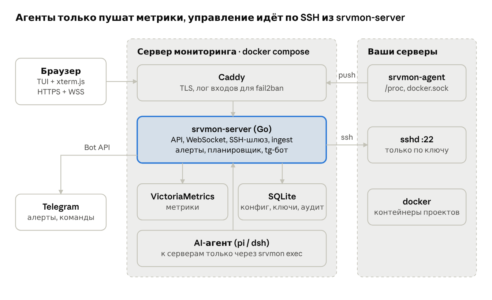
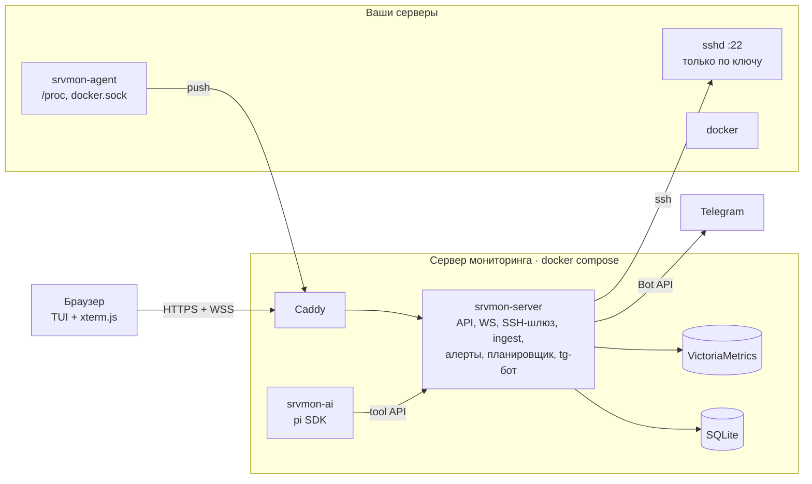
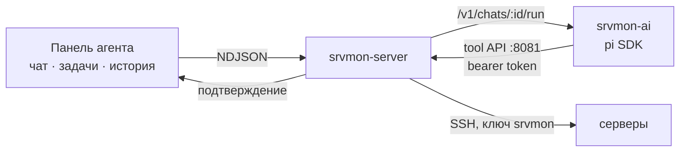

# Server Monitor (srvmon) — архитектура

Живая версия документа: https://claude.ai/artifact/EzqUFQ92dN38L4LjJcXzZ7
Макеты экранов: https://claude.ai/artifact/UHVJqLt2Jq1xeg9H9bTYjo (исходники в [`design/`](design/))

## Цели и принципы

Srvmon — личная панель для наблюдения за своими серверами и работы с ними: метрики и docker-контейнеры в реальном времени, SSH-терминал в браузере, AI-агент для задач по серверам и Telegram для критичных уведомлений.

- **Агенты только пушат.** На серверах не открываем новых входящих портов: агент сам шлёт метрики на центральный сервер по HTTPS. Входящий только SSH, и только с IP сервера мониторинга.
- **Ключи, а не пароли.** Пароль сервера используется один раз при добавлении, чтобы прописать ed25519-ключ, и нигде не сохраняется. Вход по паролю на сервере после этого отключается.
- **Один владелец.** Нет пользователей и логина: пароль, затем код Google Authenticator. Перебор режут fail2ban и rate limit.
- **Просто развернуть.** Всё запускается одним `docker compose` на сервере мониторинга, новые версии выкатываются через CI/CD автоматически.
- **TUI-стиль.** Тёмная тема, моноширинный шрифт, зелёный акцент, управление с клавиатуры, экран сервера в духе btop.

## Общая схема





На целевых серверах открыт только SSH; агент сам ходит наружу, а терминал, действия с контейнерами и команды AI-агента идут через SSH-шлюз в srvmon-server.

## Агент на сервере (srvmon-agent)

Небольшой статический бинарник на Go в distroless-образе (ожидаемо 10–20 MB, ~20 MB RAM). Запускается одной командой при онбординге сервера.

| Что | Откуда | Как часто |
| --- | --- | --- |
| CPU, load, RAM, swap, диски, сеть, uptime | `/proc`, `/sys` хоста (read-only mount) | 5 с |
| Контейнеры: статус, health, рестарты, CPU/RAM, образ, порты | Docker API через `/var/run/docker.sock` (ro) | 5 с + события сразу |
| Инвентарь: ОС, ядро, версия docker, обновления пакетов | файлы хоста | раз в час |

Для экрана сервера в стиле btop агент дополнительно шлёт загрузку по ядрам, температуру, топ-30 процессов (с привязкой к контейнеру) и строки journald/docker-логов уровня warn и выше. Процессы уходят раз в 1–2 с только пока экран сервера открыт: сервер сообщает об этом агенту в ответе на ingest.

Доставка: `POST https://<monitor>/api/ingest` с персональным токеном агента (выдаётся при добавлении, можно отозвать). Пачки в JSON+gzip; при потере связи агент держит буфер и досылает. Отсутствие данных дольше порога = алерт «сервер молчит».

Агент ничего не выполняет по команде извне: все действия идут через SSH с сервера мониторинга. Украденный токен агента даёт только право слать метрики.

## Центральный сервер

| Компонент | Выбор | Зачем |
| --- | --- | --- |
| Reverse proxy | Caddy | авто-TLS (Let's Encrypt), лог для fail2ban |
| API + WebSocket | Go, `net/http`, один бинарник `srvmon-server` | ingest, REST, live-обновления, SSH-шлюз, алерты, Telegram |
| Фронтенд | React + Vite + TypeScript, shadcn/ui (Radix) в TUI-теме, xterm.js | интерфейс из макета, терминал в браузере |
| Метрики | VictoriaMetrics (single-node) | сжатие, ретеншн, PromQL для графиков и правил |
| Конфиг и состояние | SQLite | серверы, токены, правила, алерты, аудит, задачи агента |
| Секреты | SSH-ключи и токены зашифрованы (XChaCha20-Poly1305) | мастер-ключ в файле вне БД, только на сервере |

Ретеншн по умолчанию 90 дней. Расчёт ресурсов сервера: [server-requirements.md](server-requirements.md). Дашборд получает обновления по WebSocket сразу после ingest. Компоненты интерфейса — shadcn/ui, перекрашенные под TUI: прокрутка через ScrollArea (тонкий ползунок 6 px), кнопки 36 px и компактные 24 px в таблицах.

## Карточка сервера

| Поле | Пример | Для чего |
| --- | --- | --- |
| имя, описание | shop-db, «Postgres магазина» | поиск, контекст для AI-агента |
| проект | shop | к какому решению относится |
| группа | prod / staging / infra / личные | вкладки-фильтры в обзоре, одна на сервер |
| теги | #db, #public | свободные метки |
| провайдер, тариф, ссылка на панель | Hetzner, CPX31 | быстрый переход в консоль провайдера |
| стоимость, валюта, период | 15.90 EUR / месяц | сумма расходов в рублях по курсу ЦБ |
| следующая оплата | 03.11.2026 | алерт «оплата через ≤ 3 дня» в Telegram, команда `/bills` |

## Добавление сервера и веб-терминал

1. Имя, host:port, проект, группа, теги, описание.
2. Провайдер и оплата (можно пропустить).
3. Пользователь и пароль. Сервер мониторинга заходит по паролю и запоминает host key (fingerprint показывается для сверки).
4. Генерация ed25519-пары, пользователь `srvmon` (группа docker), публичный ключ в `authorized_keys`, проверка входа по ключу, установка `srvmon-agent`, опционально `PasswordAuthentication no`. Пароль затирается; в БД и логи он не попадает.

Терминал: xterm.js ↔ WebSocket ↔ SSH-клиент в `srvmon-server` ↔ sshd. Приватный ключ никогда не попадает в браузер. Вкладки, resize, shell в контейнер (`docker exec -it`), опциональная запись сессий в аудит.

## AI-агент (pi)

Агент живёт в отдельном контейнере `srvmon-ai` на сервере мониторинга: Node 22 + SDK [pi](https://pi.dev) (`@earendil-works/pi-coding-agent`), модели любого провайдера pi (по умолчанию DeepSeek `deepseek-v4-pro`, можно Anthropic, OpenAI, OpenRouter и др.).

**Почему pi, а не dsh.** Оба open source. dsh (DeepSeek Harness) — полноценное приложение-воркспейс для кодинга в статусе developer preview (релизы `0.2.x-rc`, «будут ломающие изменения»); его веб-интерфейс слушает только конкретный IP (не `0.0.0.0`), пускает по одноразовому launch-токену и проверке Host/Origin, а в iframe приносит свой интерфейс с файлами, терминалом и workspace, который не похож на утверждённый TUI-макет. pi стабилен (1.x), встраивается как библиотека: свои инструменты, выключенные встроенные `bash/read/write/edit`, сессии в файлах, компакция и ретраи, десятки провайдеров. Поэтому панель агента — своя, как в макете, а pi работает за ней. Граница безопасности в обоих вариантах была бы одна — SSH-шлюз srvmon, поэтому dsh можно подключить позже тем же tool API.



- **Инструменты** — только srvmon: `srvmon_servers`, `srvmon_server` (метрики, контейнеры, предупреждения из логов), `srvmon_exec` (команда по SSH), `srvmon_tasks`, `srvmon_task_create`, `srvmon_task_delete`. Встроенных инструментов pi нет, SSH-ключей у контейнера нет.
- **Чтение сразу, изменения после подтверждения.** srvmon-server классифицирует каждую команду (`internal/aiagent/policy.go`): allowlist команд только для чтения (`docker ps/logs/inspect/stats --no-stream`, `compose ps/logs`, `df`, `free`, `journalctl`, `systemctl status`, `cat`, `grep` …) и конвейеры через `|`. Всё остальное (`;`, `&&`, перенаправления, `$()`, `sudo`, неизвестные программы) становится карточкой «⚠ подтвердите» в панели и ждёт до 15 минут. Решение принимает srvmon, а не модель. Команды идут под `timeout` (60 с для чтения, 10 мин после подтверждения), вывод обрезается до 32 КБ, всё пишется в аудит.
- **Чаты** привязаны к серверу (контекст терминала) или ко всем серверам. srvmon хранит то, что видно в UI (сообщения, вызовы инструментов, подтверждения), pi — контекст модели в томе `ai-data`.
- **Задачи по расписанию**: cron из 5 полей в UTC или `@every 30m`, не чаще раза в 5 минут. srvmon запускает агента с промптом задачи в отдельной сессии; результат виден во вкладке «задачи». С `notify=telegram` ответ, начинающийся с `ALERT`, или ошибка уходят в Telegram Когда агент просит изменяющую команду, бот присылает её с кнопками «выполнить» / «отклонить» (`act:<id>:ok|no` → `Server.DecideAgentAction`); решение из панели и из Telegram идёт одним путём, сработает первое. `/ask <вопрос>` в боте — разовый запрос агенту, ответ приходит отдельным сообщением.
- **Ключ API** приходит из секрета GitHub `AI_API_KEY` (через stdin при деплое в `/opt/srvmon/.env`, режим 600); провайдер и модель — переменные `SRVMON_AI_PROVIDER`, `SRVMON_AI_MODEL`. Токен между srvmon-server и srvmon-ai генерирует `remote-deploy.sh`.

## Алерты и Telegram

Правила проверяются каждые 15 с; состояния firing → acked → resolved, дедупликация. По умолчанию: агент молчит > 2 мин (crit), контейнер exited/unhealthy (crit), CPU > 90% 5 мин, диск > 85%, > 2 рестартов за час, оплата через ≤ 3 дня.

Правила редактируются на экране «алерты» (`[5]`): порог, длительность, уровень (crit / warn / info) и канал (tg — Telegram и панель, web — только панель). Тишина по ночам (по умолчанию 01:00–07:00 по Москве) задерживает всё, кроме crit; кнопка «тишина 1ч» глушит уведомления по одному алерту. Рестарты контейнера считаются по ответам агента (переход в restarting, падение uptime), контейнер с `Exited (0)` алертом не считается. События без состояния: бан fail2ban на сервере мониторинга (action `srvmon-notify` пишет баны в `/var/log/srvmon/fail2ban-events.log`, сервер его читает), подбор пароля к панели (сработал лимит попыток) и успешный вход.

Бот работает через long polling и отвечает только разрешённому chat id. Токен хранится зашифрованным мастер-ключом; chat id проще всего получить, написав боту `/start`: панель покажет чат и предложит его использовать. Если `api.telegram.org` недоступен с сервера, задайте `SRVMON_TELEGRAM_API` (адрес прокси Bot API). Команды: `/status`, `/server <имя>`, `/alerts`, `/ack <id>`, `/bills`, `/ask <вопрос>`; кнопки под алертом: ack, тишина 1ч, подтвердить действие агента. Каждый вход в панель тоже приходит в Telegram.

## Вход: пароль + TOTP + fail2ban

1. Пароль сверяется с argon2id-хешем; успех даёт промежуточный токен на 2 мин.
2. TOTP по RFC 6238 (30 с, 6 цифр, ±1 шаг), повтор кода запрещён, 10 резервных кодов.
3. Сессия — cookie `HttpOnly; Secure; SameSite=Strict`, 12 ч, CSRF-защита; WebSocket проверяет сессию и Origin.

Первичная настройка: `srvmon-server init` в консоли сервера спрашивает пароль и печатает QR-код для Authenticator.

Перебор: rate limit в приложении + fail2ban на хосте (jail `srvmon-auth`: 5 ошибок за 10 мин → бан 1 ч, повторный → 24 ч; плюс стандартный `sshd`).

## Репозиторий, CI/CD и деплой

```
srvmon/
  cmd/server/        # srvmon-server
  cmd/agent/         # srvmon-agent
  internal/          # auth, sshgw, ingest, alerts, telegram, aiagent, store, metrics
  web/               # React + Vite + xterm.js (встраивается в бинарник)
  deploy/            # docker-compose.yml, Caddyfile, fail2ban, Dockerfile'ы
  .github/workflows/ # ci.yml, release.yml, deploy.yml
  docs/              # архитектура, макеты
```

| Workflow | Когда | Что делает |
| --- | --- | --- |
| `ci.yml` | каждый PR и push | go vet, go test, сборка фронта, сборка образов без push |
| `release.yml` | push в `main` | образы `srvmon-server` и `srvmon-agent` (amd64 + arm64) → GHCR, теги sha и `latest` |
| `deploy.yml` | после release | SSH на сервер мониторинга → `docker compose pull && up -d` → healthcheck, откат при провале |

Секреты деплоя живут в GitHub Environment `production`. Агенты на серверах обновляет сам srvmon по SSH.

## Этапы

1. Каркас и CI/CD — сборка, образы в GHCR, автодеплой, вход пароль + TOTP, fail2ban.
2. Мониторинг — агент, ingest, обзор и экран сервера с docker-контейнерами.
3. Серверы и терминал — мастер добавления с генерацией ключей, веб-терминал, shell в контейнер, логи и restart. Мастер, терминал и shell в контейнер готовы; логи и restart контейнеров в UI — вместе с экраном сервера.
4. Алерты и Telegram — правила, экран алертов `#/alerts`, бот с командами и кнопками, события fail2ban и входа в панель.
5. AI-агент — pi в контейнере `srvmon-ai`, панель в терминале и раздел `[4] агент`, подтверждение изменяющих команд, задачи по расписанию.

## Открытые вопросы

- [x] Агент: pi (см. «AI-агент»), dsh можно подключить позже через тот же tool API.
- [ ] Домен для панели и сервер для деплоя.
- [ ] ОС серверов и есть ли arm64.
- [ ] Язык интерфейса: русский (как в макете) или английский.
